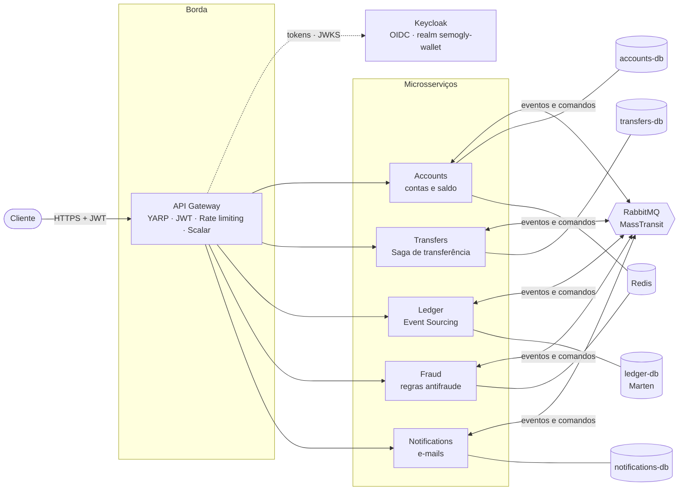
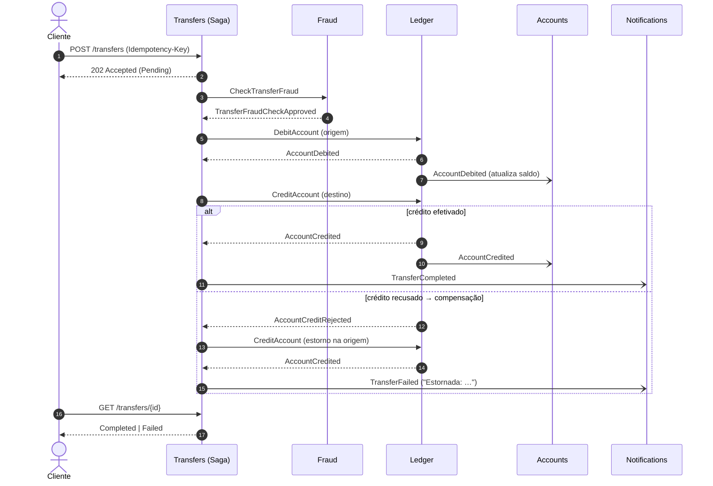

# Semogly Wallet

[](https://github.com/semog-projects/Semogly.Wallet/actions/workflows/ci.yml)


Carteira digital construída com **microsserviços em .NET 10**, mensageria e os padrões que sistemas financeiros
usam na prática: **Saga** com compensação, **Transactional Outbox/Inbox**, **Event Sourcing** com
**partidas dobradas**, antifraude em Redis, identidade no **Keycloak** e um **API Gateway** com JWT e rate limiting.

Tudo sobe com um único comando via **.NET Aspire**: bancos, broker, cache, os cinco serviços, o Gateway e o
dashboard de observabilidade.

---

## Sumário

- [Arquitetura](#arquitetura)
- [Fluxo de uma transferência](#fluxo-de-uma-transferência)
- [Livro-razão com partidas dobradas](#livro-razão-com-partidas-dobradas)
- [Stack](#stack)
- [Como rodar](#como-rodar)
- [Testando a API](#testando-a-api)
- [Testes](#testes)
- [Estrutura do repositório](#estrutura-do-repositório)
- [Decisões de arquitetura (ADRs)](#decisões-de-arquitetura-adrs)
- [Próximos passos](#próximos-passos)

---

## Arquitetura



| Serviço | Responsabilidade | Armazenamento |
|---|---|---|
| **Accounts** | Abertura de contas e consulta de saldo (projeção dos lançamentos do Ledger) | Postgres + cache híbrido (memória + Redis) |
| **Transfers** | Recebe pedidos de transferência e orquestra a **Saga** | Postgres (transferências + estado da saga) |
| **Ledger** | Livro-razão: fonte da verdade do dinheiro, com **Event Sourcing** e partidas dobradas | Postgres via **Marten** (event store) |
| **Fraud** | Limite por transação, limite diário e velocity check | Redis (script Lua atômico) |
| **Notifications** | Avisa o titular sobre conta aberta e transferências | Postgres (contatos + histórico) |
| **Gateway** | Ponto de entrada único: roteamento, autenticação, rate limiting e documentação agregada | — |

Cada serviço é dono do seu banco (**database-per-service**) e segue **Clean Architecture** em quatro projetos
(`Domain`, `Application`, `Infrastructure`, `Api`). Testes de arquitetura garantem a regra de dependência.

---

## Fluxo de uma transferência

`POST /transfers` grava a transferência e publica `TransferRequested` **na mesma transação** (outbox).
A partir daí a saga conduz o processo, e a API responde `202 Accepted` imediatamente.



Estados da saga: `AwaitingFraudCheck → AwaitingDebit → AwaitingCredit → (AwaitingRefund | AwaitingCancellation) → finalizada`.
Recusas do antifraude ou por saldo insuficiente encerram a saga como `Failed` sem mover dinheiro.

**Timeouts** (agendados no Quartz, persistido no Postgres):

- **Antifraude sem resposta em 30 s:** a transferência falha sem mover dinheiro.
- **Débito ou crédito sem resposta em 1 min:** a saga pede o cancelamento ao Ledger, que decide:
  - Se o destino já recebeu, a transferência é concluída.
  - Caso contrário, ela é cancelada, e um débito já lançado é estornado.
  - Lançamentos atrasados depois disso são ignorados. Nunca há estorno com o crédito já feito
    ([ADR 0012](docs/adr/0012-timeouts-da-saga.md)).

**Garantias:**

- **Atomicidade entre dados e mensagens:** Transactional Outbox. Nenhum evento é publicado sem o dado
  correspondente gravado, e vice-versa.
- **Idempotência ponta a ponta:**
  - `Idempotency-Key` obrigatória na API.
  - Inbox (deduplicação por `MessageId`) nos consumers.
  - Chaves determinísticas no antifraude e nas notificações.
- **Concorrência:** concorrência otimista na saga e nos agregados (`xmin` no Postgres, versão do stream no Marten).
- **Falhas transitórias:** retry com backoff; esgotadas as tentativas, a mensagem vai para a fila `_error` (dead-letter).

---

## Livro-razão com partidas dobradas

O **Ledger** não guarda "o saldo": guarda **todos os lançamentos**, imutáveis, como eventos no Marten.
O saldo é consequência deles. Todo lançamento tem contrapartida, então **a soma de todas as contas é sempre zero**.

Duas contas internas tornam isso possível:

- **CashIn:** contrapartida dos depósitos. Seu saldo negativo é o total que entrou na carteira.
- **Clearing:** dinheiro em trânsito entre o débito e o crédito da saga. Volta a zero quando as transferências terminam.

| Operação | Débito | Crédito |
|---|---|---|
| Depósito de 500 em Ana | CashIn −500 | Ana +500 |
| Transferência de 200 (débito) | Ana −200 | Clearing +200 |
| Transferência de 200 (crédito) | Clearing −200 | Bruno +200 |
| **Saldos finais** | CashIn **−500**, Clearing **0** | Ana **300**, Bruno **200** → soma **0** |

A escrita no Marten e o outbox/inbox do MassTransit (EF Core) compartilham **a mesma transação do Postgres**:
o lançamento, as mensagens publicadas e a deduplicação são confirmados juntos ([ADR 0006](docs/adr/0006-transacao-compartilhada-marten-ef.md)).

---

## Stack

| Área | Tecnologia |
|---|---|
| Plataforma | .NET 10, C# (latest), minimal APIs, validação nativa, ProblemDetails |
| Orquestração local e observabilidade | .NET Aspire 13 (dashboard, OpenTelemetry, service discovery, health checks) |
| Mensageria | RabbitMQ 4 + MassTransit 8 (Saga state machine, Outbox/Inbox, retry, dead-letter) · Quartz.NET (timeouts da saga) |
| Persistência | PostgreSQL 18 + EF Core 10 · Marten 9 (event store e projeções) |
| Cache e contadores | Redis 8 · HybridCache · scripts Lua |
| Identidade | Keycloak 26 (OIDC, realm importado pelo Aspire) · JWT RS256 validado pelo Gateway e por cada serviço · posse da conta verificada pelo Accounts |
| Borda | YARP · JWT Bearer · BFF (cliente OIDC confidencial, sessão no Redis) · Rate Limiting · SignalR · Scalar (OpenAPI agregado) |
| App do cliente | Flutter 3 · Riverpod · go_router · dio · clientes Dart gerados do OpenAPI (swagger_parser) · token no Keychain/Keystore |
| Backoffice web | React 19 · TypeScript · Vite · TanStack Query · React Router · Tailwind + shadcn/ui · cliente gerado do OpenAPI (openapi-fetch) · Vitest |
| Testes | xUnit v3 · MassTransit Test Harness · Testcontainers · WebApplicationFactory |
| Qualidade | Central Package Management · analisadores com `TreatWarningsAsErrors` · testes de arquitetura · GitHub Actions |

---

## Como rodar

**Pré-requisitos:** [.NET 10 SDK](https://dotnet.microsoft.com/download), [Node.js 24](https://nodejs.org) (backoffice web) e Docker em execução.

```bash
git clone https://github.com/semog-projects/Semogly.Wallet.git
cd Semogly.Wallet
dotnet run --project src/Aspire/Semogly.Wallet.AppHost
```

O AppHost sobe Postgres (com pgAdmin), RabbitMQ (com painel de gerenciamento), Redis, Keycloak, os cinco serviços, o
Gateway e o **backoffice web** (React + Vite, com `npm install` automático). As migrations e o schema do Marten são
aplicados automaticamente em Development.

| O quê | Onde |
|---|---|
| Dashboard do Aspire (logs, traces, métricas) | URL exibida no terminal (padrão `https://localhost:17110`) |
| **Backoffice web** (React) | `http://localhost:5173`. "Entrar com Keycloak" com `backoffice@semogly.dev` / `Senha@123` |
| **Gateway + Scalar com toda a API** | `https://localhost:7100/scalar` |
| **Keycloak** (console de administração) | `http://localhost:8080` · usuário `admin`, senha no parâmetro `keycloak-password` do dashboard |
| RabbitMQ e pgAdmin | Links no dashboard do Aspire |
| **App do cliente** (Flutter) | `cd apps/mobile && flutter run` com um emulador Android aberto (ver [apps/mobile](apps/mobile/README.md)) |

> Os containers usam `ContainerLifetime.Persistent`: continuam rodando entre execuções e os dados são preservados
> em volumes.

### Usuários de demonstração

O realm `semogly-wallet` é importado de
[`Realms/semogly-wallet-realm.json`](src/Aspire/Semogly.Wallet.AppHost/Realms/semogly-wallet-realm.json) na
subida do Keycloak. Todos usam a senha `Senha@123`:

| Usuário | Papel | Uso |
|---|---|---|
| `maria.demo@email.com` | `customer` | App do cliente |
| `joao.destino@email.com` | `customer` | Destinatário das transferências de exemplo |
| `ana@email.com` | `customer` | Exemplos com `curl` |
| `backoffice@semogly.dev` | `operator` | Backoffice web e depósitos |

> O Keycloak escuta em `http://localhost:8080`, e esse endereço é o `iss` de todos os tokens (web, app, Gateway).
> HTTP só em desenvolvimento: o emulador Android não confia no certificado de desenvolvimento do .NET.

---

## Testando a API

Todas as rotas passam pelo Gateway em `https://localhost:7100/api/...` e exigem um JWT do Keycloak, validado também
por cada serviço. Cliente só acessa as próprias contas (e-mail do token igual ao da conta); `operator` acessa
todas (os exemplos usam `curl` e `jq`). Em Development, o Gateway troca usuário e senha por um token (password grant do cliente
`wallet-gateway`):

```bash
GW=https://localhost:7100

# Token de cliente e token de operador (depósitos exigem o papel "operator")
TOKEN=$(curl -sk -X POST $GW/auth/token -H "content-type: application/json" \
  -d '{"username":"ana@email.com","password":"Senha@123"}' | jq -r .accessToken)
OPS=$(curl -sk -X POST $GW/auth/token -H "content-type: application/json" \
  -d '{"username":"backoffice@semogly.dev","password":"Senha@123"}' | jq -r .accessToken)

# Abrir duas contas: cliente só no próprio e-mail; operador para qualquer titular
ANA=$(curl -sk -X POST $GW/api/accounts -H "Authorization: Bearer $TOKEN" -H "content-type: application/json" \
  -d '{"ownerName":"Ana Souza","document":"12345678909","email":"ana@email.com"}' | jq -r .id)
BRUNO=$(curl -sk -X POST $GW/api/accounts -H "Authorization: Bearer $OPS" -H "content-type: application/json" \
  -d '{"ownerName":"Bruno Lima","document":"98765432100","email":"bruno@email.com"}' | jq -r .id)

# Depósito (simula a entrada de um PIX/boleto)
curl -sk -X POST $GW/api/ledger/accounts/$ANA/deposits -H "Authorization: Bearer $OPS" \
  -H "content-type: application/json" -d '{"amount":500}'

# Transferência (assíncrona: 202 + acompanhar pelo GET)
TRANSFER=$(curl -sk -X POST $GW/api/transfers -H "Authorization: Bearer $TOKEN" \
  -H "Idempotency-Key: $(uuidgen)" -H "content-type: application/json" \
  -d "{\"sourceAccountId\":\"$ANA\",\"destinationAccountId\":\"$BRUNO\",\"amount\":200}" | jq -r .id)

curl -sk $GW/api/transfers/$TRANSFER -H "Authorization: Bearer $TOKEN"                 # Completed
curl -sk $GW/api/ledger/accounts/$ANA/statement -H "Authorization: Bearer $TOKEN"      # extrato
curl -sk $GW/api/notifications/accounts/$BRUNO -H "Authorization: Bearer $OPS"         # "Você recebeu R$ 200,00"
curl -sk $GW/api/accounts/$BRUNO -H "Authorization: Bearer $TOKEN"                     # 403: conta de outro titular
```

Também dá para fazer tudo pelo **Scalar** em `https://localhost:7100/scalar`: gere o token em `/auth/token` e
informe-o na autenticação Bearer.

### Principais endpoints

| Método | Rota | Descrição |
|---|---|---|
| `POST` | `/auth/token` | Troca usuário e senha por um token do Keycloak (só em Development: Scalar e curl) |
| `GET` | `/bff/login?returnUrl=` | Login OIDC do web: redireciona para o Keycloak (Authorization Code + PKCE + PAR) e cria a sessão em cookie `HttpOnly`; os tokens ficam no Redis |
| `POST` | `/bff/logout` | Encerra a sessão do web e a do Keycloak (logout federado). Exige o header `X-CSRF: 1` |
| `GET` | `/bff/user` | Usuário e papéis da sessão atual |
| `POST` | `/api/accounts` | Abre uma conta (cliente só no próprio e-mail) |
| `GET` | `/api/accounts/lookup?email=` | Destinatário pela chave (e-mail): id e nome mascarado ("Joao D."), para confirmar antes de transferir |
| `GET` | `/api/accounts/me` | Contas do titular (e-mail do token) |
| `GET` | `/api/accounts/{id}` · `/api/accounts/{id}/balance` | Dados e saldo da conta (titular ou `operator`) |
| `POST` | `/api/ledger/accounts/{id}/deposits` | Depósito (papel `operator`) |
| `GET` | `/api/ledger/accounts/{id}/statement` | Extrato paginado (titular ou `operator`) |
| `POST` | `/api/transfers` | Solicita transferência a partir de conta própria (`Idempotency-Key` obrigatória; até 10 por minuto por usuário) |
| `GET` | `/api/transfers/{id}` | Status da transferência (titular da origem ou do destino, ou `operator`) |
| `GET` | `/api/fraud/accounts/{id}/daily-usage` | Uso do limite diário (titular ou `operator`) |
| `GET` | `/api/notifications/accounts/{id}` | Notificações enviadas (titular ou `operator`) |
| `GET` | `/api/accounts?search=` | Busca de contas por nome, e-mail ou CPF (backoffice, papel `operator`) |
| `GET` | `/api/transfers?status=&accountId=&from=&to=` | Listagem paginada de transferências (backoffice, papel `operator`) |
| `GET` | `/api/ledger/book` | Visão do livro: CashIn, Clearing, clientes e total, que deve ser zero (papel `operator`) |
| `WS` | `/hubs/transfers` | SignalR: `SubscribeToAccount(id)` (só contas próprias) e o evento `TransferUpdated` (status em tempo real; `operator` recebe todas) |

### Regras antifraude (configuráveis em `FraudPolicy`)

| Regra | Padrão |
|---|---|
| Limite por transação | R$ 5.000 |
| Limite diário por conta (fuso de Brasília) | R$ 10.000 |
| Velocity | 5 transferências por minuto |

> Para ver o **retry e o dead-letter** em ação, abra uma conta com e-mail `@falha.test`: o provedor fake de e-mail
> falha e a mensagem termina na fila `notifications-account-created_error` após as novas tentativas.

---

## Testes

```bash
dotnet test
```

| Projeto | O que cobre |
|---|---|
| `*.UnitTests` | Domínio, handlers (com fakes) e a **Saga** no test harness do MassTransit |
| `ArchitectureTests` | Regra de dependência da Clean Architecture nos cinco serviços |
| `AppHost.Tests` | Modelo de recursos do Aspire (sem subir containers) |
| `IntegrationTests` | **Testcontainers** (Postgres, RabbitMQ, Redis) + os cinco serviços em memória: fluxo completo de transferência (sucesso, compensação, saldo insuficiente, antifraude, idempotência concorrente), atomicidade Marten + EF e o script Lua do antifraude |

Os testes de integração precisam de Docker. No CI (GitHub Actions) toda a suíte roda a cada pull request.

---

## Estrutura do repositório

```
src/
├── Aspire/
│   ├── Semogly.Wallet.AppHost          # orquestração local (containers, serviços, parâmetros, realm do Keycloak)
│   └── Semogly.Wallet.ServiceDefaults  # OpenTelemetry, health checks, resiliência, OpenAPI
├── BuildingBlocks/
│   ├── Semogly.Wallet.SharedKernel     # Result/Error, ICommandHandler/IQueryHandler, DomainException
│   ├── Semogly.Wallet.Contracts        # eventos e comandos de integração
│   └── Semogly.Wallet.Messaging        # MassTransit + RabbitMQ + Outbox/Inbox
├── Gateway/
│   └── Semogly.Wallet.Gateway          # YARP, JWT, rate limiting, Scalar agregado
└── Services/
    ├── Accounts/       ┐
    ├── Transfers/      │ cada um com Domain · Application · Infrastructure · Api
    ├── Ledger/         │
    ├── Fraud/          │
    └── Notifications/  ┘
tests/
├── Semogly.Wallet.{Serviço}.UnitTests
├── Semogly.Wallet.ArchitectureTests
├── Semogly.Wallet.AppHost.Tests
└── Semogly.Wallet.IntegrationTests
docs/adr/                               # decisões de arquitetura
```

---

## Decisões de arquitetura (ADRs)

| # | Decisão |
|---|---|
| [0001](docs/adr/0001-microsservicos-com-aspire.md) | Microsserviços orquestrados localmente com .NET Aspire |
| [0002](docs/adr/0002-masstransit-rabbitmq-outbox.md) | MassTransit 8 + RabbitMQ com Transactional Outbox/Inbox |
| [0003](docs/adr/0003-saga-orquestrada.md) | Saga orquestrada para transferências |
| [0004](docs/adr/0004-clean-architecture-sem-mediatr.md) | Clean Architecture por serviço, com handlers próprios (sem MediatR) |
| [0005](docs/adr/0005-ledger-event-sourcing-partidas-dobradas.md) | Ledger com Event Sourcing (Marten) e partidas dobradas |
| [0006](docs/adr/0006-transacao-compartilhada-marten-ef.md) | Transação compartilhada entre Marten e o outbox do EF Core |
| [0007](docs/adr/0007-antifraude-redis-lua.md) | Regras antifraude com estado no Redis via script Lua atômico |
| [0008](docs/adr/0008-gateway-yarp-jwt.md) | API Gateway com YARP, JWT e rate limiting |
| [0009](docs/adr/0009-testes-de-integracao.md) | Testes de integração com Testcontainers e serviços em memória |
| [0010](docs/adr/0010-keycloak-identity-provider.md) | Keycloak como Identity Provider |
| [0011](docs/adr/0011-posse-da-conta.md) | Posse da conta e validação do JWT em todos os serviços |
| [0012](docs/adr/0012-timeouts-da-saga.md) | Timeouts da saga com cancelamento arbitrado pelo Ledger |

---

## Próximos passos

- **Ledger:** snapshots dos agregados, para evitar ler o stream inteiro a cada operação.
- **Depósitos:** `Idempotency-Key` no endpoint.
- **Deploy:** `azd` ou Kubernetes a partir do manifesto do Aspire.

## Licença

[MIT](LICENSE)
